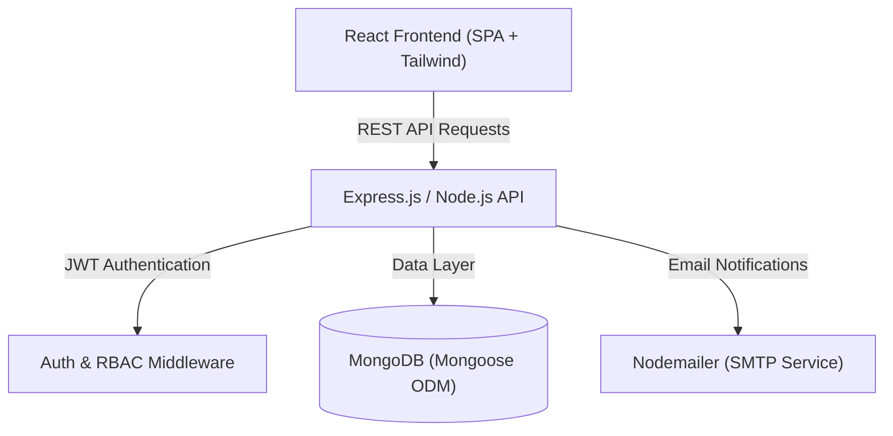

# Saweriya Travellers (DriveBus) 🚌

[](https://nodejs.org/)
[](https://react.dev/)
[](https://expressjs.com/)
[](https://www.mongodb.com/)
[](https://tailwindcss.com/)
[](LICENSE)

An enterprise-grade, full-stack **Bus Reservation & Fleet Management System** designed for modern travel operators. Built with the **MERN** stack, Saweriya Travellers (DriveBus) provides an interactive customer booking experience alongside an administrative portal for fleet logistics, ticket auditing, schedule management, and real-time seat allocation.

---

## 🌟 Key Features

### 👤 Customer Experience (Frontend)
- **Interactive Seat Selection Grid**: Visual lower & upper deck layouts with gender-aware seat locking (Ladies/Gents seat separation rules).
- **Dynamic Search & Filtering**: Autocomplete bus stop selection with matching destination imagery, departure times, and price sorting.
- **Instant Booking & E-Tickets**: Real-time seat hold, fare computation, discount coupon application, and downloadable digital bus tickets.
- **Authentication & Profiles**: Secure JWT-based customer login, signup, password reset with OTP, profile management, and ticket booking history.

### 🛡️ Administrative Portal
- **Fleet & Route Management**: Register buses, configure multi-axle / sleeper / seating configurations, and manage intermediate stops.
- **Dynamic Scheduling**: Assign buses, drivers, conductors, and daily departure schedules with departure cutoff automation.
- **Reporting & Analytics**: Comprehensive dashboards tracking daily bookings, revenue metrics, seat occupancy rates, and passenger manifests.
- **Coupon & Offer Management**: Create promotional discount codes with validity periods and usage caps.

---

## 🏗️ Architecture & Tech Stack



| Layer | Technology |
| :--- | :--- |
| **Frontend** | React 18, React Router, Tailwind CSS, Lucide Icons, Axios |
| **Backend** | Node.js, Express.js, RESTful Architecture |
| **Database** | MongoDB with Mongoose ODM |
| **Authentication** | JSON Web Tokens (JWT) with bcrypt hashing & RBAC |
| **Deployment** | Render (API Web Service) & Vercel (Frontend SPA) |

---

## 📁 Project Structure

```
DriveBus/
├── backend/
│   ├── config/             # Database connection & configurations
│   ├── controller/         # Admin & Frontend business logic
│   ├── middleware/         # JWT verification, RBAC, file uploads
│   ├── model/              # Mongoose schemas (Bus, Route, Booking, User, etc.)
│   ├── router/             # Modular API route definitions
│   ├── utils/              # Helper utilities (JWT, Slug generators, etc.)
│   ├── server.js           # Server entry point
│   └── package.json
├── frontend/
│   ├── public/             # Static web assets
│   ├── src/
│   │   ├── components/     # Reusable UI components
│   │   ├── pages/          # Admin and Client view pages
│   │   ├── Service/        # API integration clients (Axios)
│   │   ├── utils/          # Formatting & route helper functions
│   │   ├── App.js          # Routing & layout orchestration
│   │   └── index.js
│   └── package.json
├── render.yaml             # Render deployment configuration
└── README.md
```

---

## 🚀 Getting Started

### Prerequisites
- [Node.js](https://nodejs.org/) (v18 or higher)
- [MongoDB](https://www.mongodb.com/) (Local community edition or MongoDB Atlas)
- [Git](https://git-scm.com/)

### 1. Clone Repository
```bash
git clone https://github.com/anuragcharan975-bit/Saweriya-Travellers.git
cd Saweriya-Travellers
```

### 2. Backend Setup
```bash
cd backend
npm install
```
Create a `.env` file in the `backend/` directory (refer to `.env.example`):
```env
PORT=4000
MONGO_URI=mongodb://127.0.0.1:27017/anurag_travels
JWT_SECRET=your_secure_jwt_secret_key_here
ADMIN_EMAIL=admin@gmail.com
ADMIN_PASSWORD=your_admin_password
```
Start the backend server:
```bash
npm start
# Server runs on http://localhost:4000
```

### 3. Frontend Setup
```bash
cd ../frontend
npm install
npm start
# Client application opens on http://localhost:3000
```

---

## 🔒 Security & Best Practices
- **Environment Isolation**: All sensitive credentials and API tokens are managed via environment variables.
- **Password Security**: Passwords are cryptographically hashed using **bcrypt** with salt rounds before database persistence.
- **Route Guarding**: Role-based access control (RBAC) middleware guarantees administrative endpoints are strictly protected.

---

## 👨‍💻 Author
**Anurag Charan**  
- GitHub: [@anuragcharan975-bit](https://github.com/anuragcharan975-bit)  
- Email: anuragcharan975@gmail.com

---

## 📄 License
This project is licensed under the MIT License.
